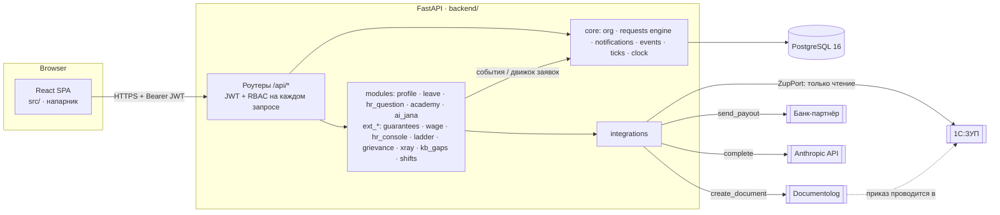

# Архитектура JanaМен

## Места интеграций

| Система | Где в коде | Сейчас | Как подключить настоящую |
|---|---|---|---|
| 1С:ЗУП | `backend/app/integrations/zup/` | `MockZup` читает таблицы `zup_*` из seed | Реализовать `ZupPort` (OData или HTTP-сервис 1С: сотрудники, табель, начисления, остатки отпуска), вернуть её из `get_zup()`. Модули не меняются |
| Documentolog | `backend/app/integrations/documentolog/` | Таблица `documents`, документ сразу «зарегистрирован» | Вызов API Documentolog в `create_document`, статус по webhook |
| Банк | `backend/app/integrations/bank/` | Таблица `payouts`, всегда успех | API банка-партнёра для выплат «Зарплаты по факту» |
| LLM (AI Jana) | `backend/app/integrations/llm/` | Claude (`claude-opus-5-5`, effort `low`, серверный фолбэк при отказе модели). Без ключа или при сбое — экстрактивный режим | `ANTHROPIC_API_KEY` в env, ключ только на сервере |

## Принципы

1. **Официальные кадровые данные только читаются.** Приложение не пишет в `zup_*`.
   Изменения (отпуск, аванс) уходят документом через Documentolog, и 1С проводит его сама.
   В mock остаток отпуска = значение в 1С − приказы `leave_order`.
2. **Права проверяет сервер** на каждом запросе. Пользователь определяется из JWT, `employeeId` и роли из тела запроса не принимаются.
3. **Кадровые решения не принимает AI.** Системные решения (`decide_by_system`) принимаются только по политикам, настроенным HR.
4. **Время берётся из `clock.now()`.** Демо переводит часы, и фоновый тик сразу отрабатывает сроки.
5. **Модули изолированы.** Они общаются через события и движок заявок, а не через внутренности друг друга. Ext-фичи выключаются флагом `EXT_FEATURES`.

## Данные (каркас)

| Таблица | Что |
|---|---|
| `countries`, `units`, `employees` | Оргструктура, роли, страна, руководитель |
| `zup_salaries`, `zup_timesheets`, `zup_hr_attrs`, `zup_hire_offers` | Зеркало 1С:ЗУП (mock, только чтение) |
| `requests`, `request_events` | Движок заявок: тип, статус, payload, версия, история |
| `notifications` | Уведомления (ключи i18n + параметры, рендер на языке получателя) |
| `documents`, `payouts` | Mock Documentolog и банка |
| `demo_state` | Смещение демо-часов |

## Модули и связи

Модули не импортируют внутренности друг друга. Они связаны через события каркаса, движок заявок и публичные сервисы.

| Модуль | Флаг | Подписан на / использует | Публикует |
|---|---|---|---|
| `profile` | — | точка расширения профиля (поля от других модулей) | — |
| `leave` | — | движок заявок, `request.before_decision` (перепроверка остатка), `request.decided` → приказ в Documentolog | — |
| `hr_question` | — | движок заявок (согласующий — HR) | — |
| `academy` | — | — | `academy.course_completed`, `academy.assigned` |
| `ai_jana` | — | база знаний страны, профиль (свои данные из 1С), `integrations/llm` | `ai.unanswered`; публичный сервис базы |
| `ext_guarantees` | `guarantees` | `request.created` (срок), `request.before_decision` (отказ только с причиной), тик (истёкшие сроки) | бейдж в карточке заявки; публичный сервис политик |
| `ext_wage` | `wage_access` | табель 1С, политики, Documentolog, банк | тип заявки `wage_access` |
| `ext_hr_console` | `hr_console` | заявки, гарантии, офферы 1С, тик. **Не читает** выводы ЗП и вопросы к AI | пересмотры зарплаты (сервис для лестницы) |
| `ext_ladder` | `ladder` | `academy.course_completed`, 1С, пересмотры радара | — |
| `ext_grievance` | `grievance` | движок заявок, гарантии (срок 72 ч) | — |
| `ext_xray` | `xray` | заявки, гарантии, радар | — |
| `ext_kb_gaps` | `kb_gaps` | `ai.unanswered`, публичный сервис базы AI | черновики и публикация правил |
| `ext_shifts` | `shifts` | ставка из 1С | — |

## Конкурентность

Транзакция коммитится до отправки ответа. Решения, отзыв, вывод денег и взятие смены блокируют свою строку.
Подача заявок сериализуется по сотруднику (`FOR NO KEY UPDATE`), номера выдаёт атомарный счётчик.
Всё это проверяется в `scripts/smoke_api.py` параллельными запросами на Postgres.
